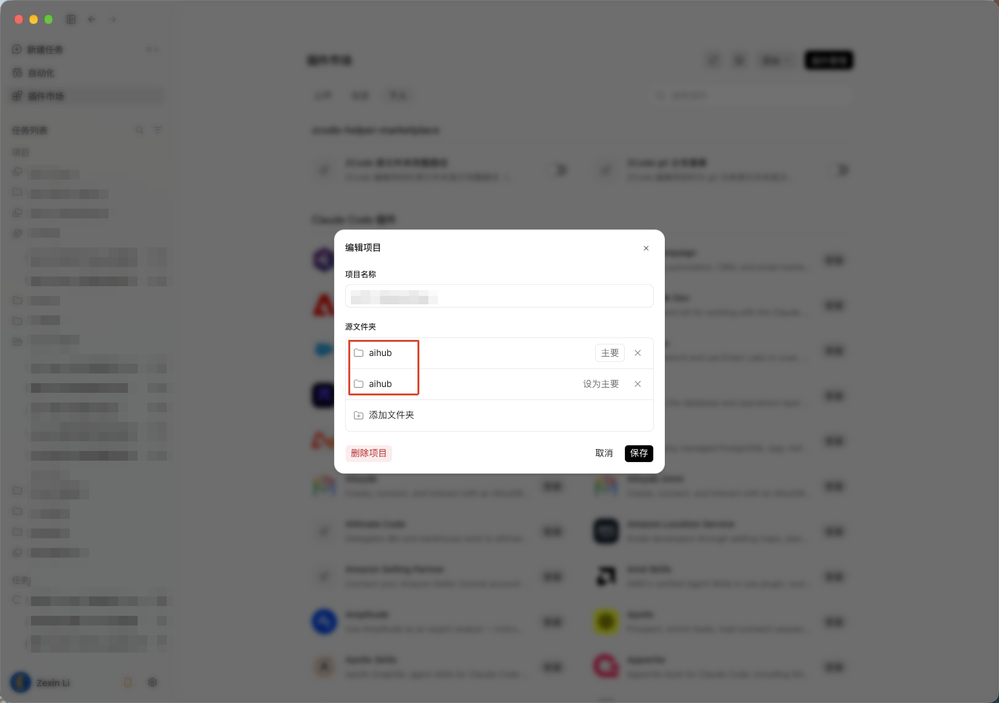
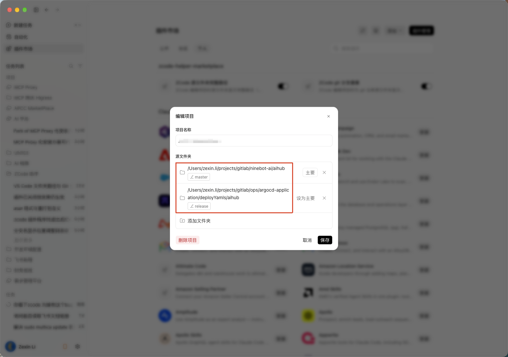
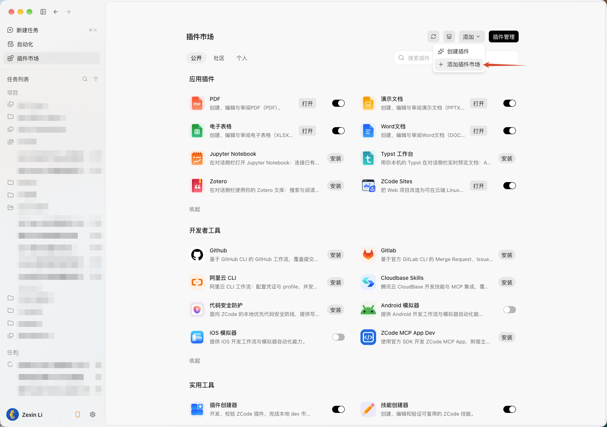
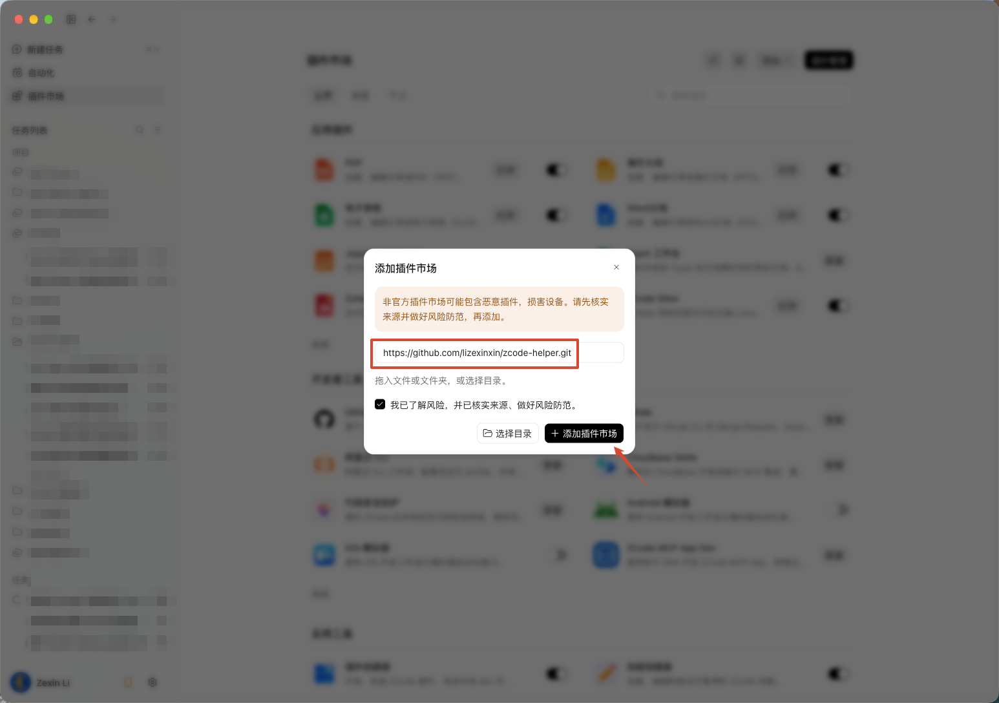
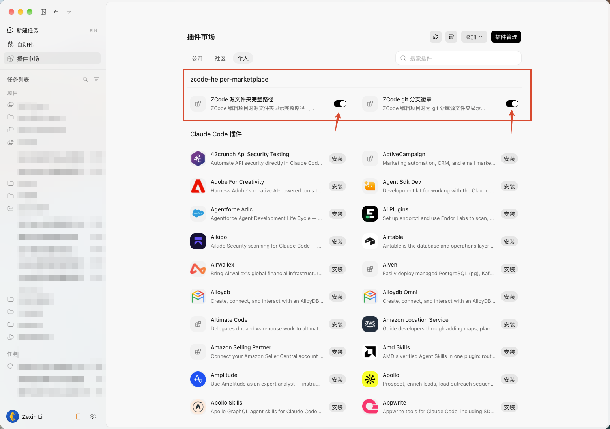

# zcode-helper

自用 ZCode 桌面客户端 UI 定制插件市场，包含两个**互相独立**的插件，
可单独安装、单独开关：

1. **ZCode 源文件夹完整路径**（`zcode-folder-full-path`）：编辑项目时，「源文件夹」
   列表直接显示完整路径，解决不同路径下同名文件夹无法区分的问题。
2. **ZCode git 分支徽章**（`zcode-branch-badge`）：编辑项目时，git 仓库源文件夹显示
   当前分支徽章（如 `⎇ main`）；非 git 目录不显示。

## 为什么需要它

在 ZCode 中编辑项目时，「源文件夹」一栏**只显示最内层文件夹的名字**。
目录一多，问题立刻暴露：

- **同名文件夹无法区分**：一个项目同时挂了多个同名目录（比如
  `~/projects/gitlab/ninebot-ai/aihub` 和
  `~/projects/gitlab/ops/argocd-application/deployYamls/aihub`），
  界面上就是两行一模一样的 `aihub`，哪个在前哪个在后全靠记，
  一旦选错，任务就在错误的目录里跑。
- **看不出当前分支**：项目关联了多个 git 仓库时，界面上没有任何分支信息，
  想确认现在在哪个分支，只能自己去终端敲 `git branch`。

开启插件后，还是那个「编辑项目」界面——每个源文件夹直接显示**完整路径**，
git 仓库额外带上**当前分支徽章**，一眼可辨：

**关闭插件**：两行一模一样的 `aihub`，完全分不清谁是谁，也看不到任何分支信息：



**开启插件**：同样的项目，完整路径 + 分支徽章（`⎇ master` / `⎇ release`）：



两个插件互不依赖：只装 folder-full-path 就只有完整路径；只装 branch-badge
就只有分支徽章。

## 安装

### 1. 添加插件市场

打开 ZCode 的 **插件市场 → 添加 → 添加插件市场**：



在弹窗里粘贴本仓库的 git 地址，勾选风险确认后点「添加插件市场」：

```
https://github.com/lizexinxin/zcode-helper.git
```



ZCode 会在仓库根目录找到 `marketplace.json`，市场名称为 `zcode-helper-marketplace`。

网络访问 GitHub 不方便时，也可以把本仓库克隆到本地后粘贴本地目录
（注意是**仓库根目录**）：

```
<path-to-clone>/zcode-helper
```

### 2. 安装并启用插件

在 **个人** 标签页里找到 `zcode-helper-marketplace`，安装想要的插件
（两个互不依赖，按需二选一或都装），并打开开关：



### 3. 首次安装 loader（一次性，之后零重启）

新开一个会话，SessionStart hook 会自动执行 `loader install`（幂等）：
同步 loader 资产到 `~/.zcode/zcode-helper/`，并整包重打包 app.asar
写入一行 `import()` 指针。

也可以手动执行：

```bash
python3 plugins/zcode-folder-full-path/scripts/zcode_helper.py loader install
```

**完全退出 ZCode**（菜单 → 退出，关闭窗口不算），再重新打开一次。
这是最后一次因为装插件而重启——之后一切改动都即时生效。

## 开关即插即用

loader 安装完成后，**插件市场里的开关拨动立即生效**（运行中即时变化，无需重启）：

- 开关拨到开 → 立即注入对应 UI 模块；
- 开关拨到关 → 立即完整拆除（DOM、样式、监听全部移除，无残留）；
- 新开窗口/页面刷新后自动重放已启用模块。

## 常用命令

| 操作 | 命令（任一插件脚本均可） |
|---|---|
| 安装 loader（幂等） | `loader install` |
| 查看注入状态 | `loader status` |
| 完全卸载注入 | `loader remove` |
| 分支服务（徽章数据源） | `daemon start` / `daemon status` |

```bash
python3 plugins/zcode-branch-badge/scripts/zcode_helper.py loader status
python3 plugins/zcode-branch-badge/scripts/zcode_helper.py daemon status
```

对应 slash 命令：`/folder-full-path-apply`（= loader install）、
`/branch-badge-restore`（= loader remove）、`/branch-badge-status` 等。

## 原理

ZCode 的插件机制没有任何 UI 扩展点，界面代码打包在
`/Applications/ZCode.app/Contents/Resources/app.asar`，且只在启动时加载一次。
本仓库采用**主进程 loader + 运行时注入**架构：

```
app.asar 的 out/main/index.js 尾部只有一行 dynamic import() 指针
  → 指向磁盘上的 ~/.zcode/zcode-helper/loader.cjs（常驻主进程）
      ├─ fs.watch ~/.zcode/cli/config.json 的 enabledPlugins（插件开关实时落盘处）
      ├─ 开关变化 → webContents.executeJavaScript 注入/拆除模块（DOM 立即变化）
      └─ 新窗口 / 页面刷新 → 自动重放已启用模块（模块幂等）
```

- **渲染模块**（`~/.zcode/zcode-helper/modules/*.js`）每次注入都从磁盘现读：
  改模块代码，下次开关切换或页面刷新即用新版，零重启、不碰 asar。
- **folder-full-path** 模块是纯 CSS 覆盖（锚定 `data-testid` 语义钩子，
  不碰压缩后的 React 代码）；**branch-badge** 模块渲染徽章 DOM 并向
  本地 `zch-branch-daemon`（端口 39217-39221，仅绑定 127.0.0.1，只读 git 查询）
  查询分支。
- 每个模块都实现幂等的 `install()/dispose()`：注入的 DOM 带 `data-zch-module`
  标记，拆除时按标记全量清理。
- 首次安装需要整包重打包 asar（约 307MB，重算 header 与 integrity），
  之后只有这一行指针与 asar 相关；`loader remove` 对称剥离指针还原原版。
- 运行日志在 `~/.zcode/zcode-helper/loader.log`，loader 的任何异常只写日志，
  不影响 ZCode 主进程。

已验证 ZCode 版本：**3.18.2**（3.16.3 / 3.17.1 为旧等长替换路线的验证版本）。

### ZCode 升级后

ZCode 自动更新会替换整个 `.app`，asar 指针丢失。各插件的 `SessionStart` hook
会在新会话启动时自动重装（默认开启，可在 `~/.zcode/<插件名>/config.json` 里设置
`{"autoApply": false}` 关闭），重装后重启一次 ZCode 即恢复；渲染模块不受升级影响。

## 修改引擎与模块（shared/ 真源与副本）

引擎（`zcode_helper.py`）、SessionStart hook（`session-start.py`）、
loader（`loader.cjs`）与渲染模块（`modules/*.js`）的真源在 `shared/`，
两个插件目录里是**逐字节相同**的分发副本。改 bug 只改 `shared/`，
然后同步到所有副本：

```bash
for f in zcode_helper.py:scripts session-start.py:hooks loader.cjs:loader; do
  src=${f%%:*}; dst=${f##*:}
  cp shared/$src plugins/zcode-folder-full-path/$dst/
  cp shared/$src plugins/zcode-branch-badge/$dst/
done
cp shared/modules/*.js plugins/zcode-folder-full-path/loader/modules/
cp shared/modules/*.js plugins/zcode-branch-badge/loader/modules/
python3 tests/test_engine_sync.py   # 校验副本与真源一致
```

## 测试

```bash
python3 tests/test_asar_repack.py      # asar 重打包核心（含真实 asar 只读往返）
python3 tests/test_loader_commands.py  # loader install/remove/status（合成 asar）
python3 tests/test_patch_engine.py     # 引擎既有能力（{{ident}}/{{data_dir}} 等，合成 asar）
python3 tests/test_branch_daemon.py    # 本地分支服务（真实起服务、查临时 git 仓库）
python3 tests/test_session_hook.py     # SessionStart hook
python3 tests/test_engine_sync.py      # shared/ 与副本同步
node --test tests/test_loader.cjs      # loader 纯逻辑
node --test tests/test_modules.cjs     # 渲染模块协议与幂等（DOM stub）
```

除「真实 asar 只读往返」外，用例不会碰真实的 `app.asar` 和 `~/.zcode/`。

## 风险与边界

- 首次安装会修改 `/Applications/ZCode.app` 内的 `app.asar`，属于对官方客户端的
  第三方修改，不是官方功能。ZCode 升级会覆盖它（hook 会自动重装）。
- `loader remove` 可对称还原原版 asar；还原后的 `out/main/index.js` 与原始内容一致。
- 注入代码只做界面显示，不读取文件、不发出外部网络请求（徽章数据仅访问
  127.0.0.1 的本地 daemon）。
- macOS 上如果 `/Applications` 不可写，可把 ZCode 复制到 `~/Applications`
  后用 `--asar` 参数指向，或用 sudo 运行脚本。

## 目录结构

```
marketplace.json                     # 插件市场清单（仓库根，ZCode 添加 git 市场时在此查找）
shared/
  zcode_helper.py                    # 引擎真源（asar 解析/重打包 + loader 命令 + daemon）
  session-start.py                   # SessionStart hook 真源（自动安装 loader）
  loader.cjs                         # 主进程 loader 真源
  modules/                           # 渲染模块真源
    folder-full-path.js              #   完整路径（纯 CSS）
    branch-badge.js                  #   分支徽章（DOM + daemon 查询）
plugins/
  zcode-folder-full-path/            # 插件1：源文件夹完整路径
    .zcode-plugin/plugin.json
    loader/{loader.cjs, modules/}    # 副本
    scripts/zcode_helper.py          # 副本
    hooks/{hooks.json, session-start.py}
    commands/  skills/
  zcode-branch-badge/                # 插件2：git 分支徽章
    .zcode-plugin/plugin.json
    loader/{loader.cjs, modules/}    # 副本
    scripts/{zcode_helper.py, zch_branch_daemon.py}
    hooks/{hooks.json, session-start.py}
    commands/  skills/
docs/
  images/                            # README 截图
  superpowers/                       # 设计与实施记录（plans/specs）
tests/
  test_asar_repack.py               # asar 重打包测试
  test_loader_commands.py           # loader 命令测试
  test_patch_engine.py              # 引擎既有能力测试
  test_branch_daemon.py             # 分支服务测试
  test_session_hook.py              # hook 测试
  test_engine_sync.py               # shared/ 与副本同步校验
  test_loader.cjs  test_modules.cjs # loader / 模块 node 测试
```
